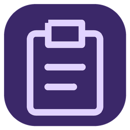
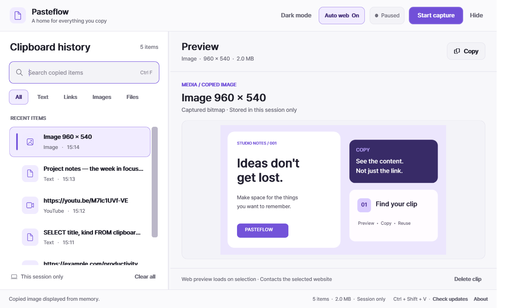
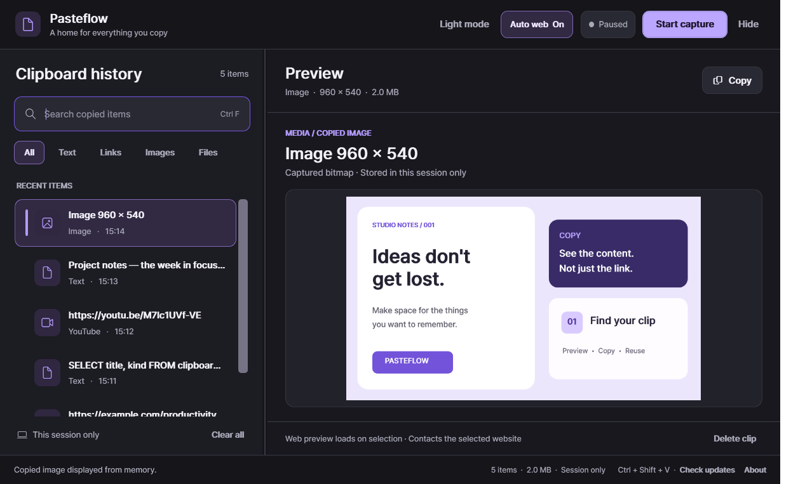
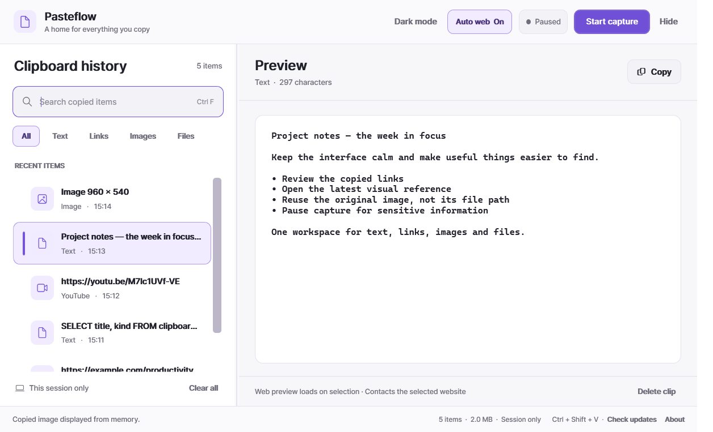

  

<h1 align="center">Pasteflow</h1>

<strong>Copy once. Find it, preview it, use it again.</strong>

A lightweight Windows clipboard workspace with an intuitive, visual preview pane.

  <a href="https://github.com/memeseonew-eng/Pasteflow/releases/download/v0.1.0-beta.1/Pasteflow-v0.1.0-beta.1-Setup-win-x64.exe"><strong>Download for Windows (Setup)</strong></a>
  &nbsp;&nbsp;·&nbsp;&nbsp;
  <a href="https://github.com/memeseonew-eng/Pasteflow/releases/download/v0.1.0-beta.1/Pasteflow-v0.1.0-beta.1-Portable-win-x64.zip"><strong>Portable ZIP</strong></a>
  &nbsp;&nbsp;·&nbsp;&nbsp;
  <a href="https://github.com/memeseonew-eng/Pasteflow/releases/tag/v0.1.0-beta.1">Beta 1 release notes</a>

> **Public beta 0.1.0-beta.1** · Windows x64 · No account · Capturing begins paused · Session-only history

*Actual Pasteflow WPF window on Windows 11 at 125% scaling, populated exclusively with synthetic demonstration content.*

## Why Pasteflow?

**Your clipboard deserves more than a plain-text list.** Pasteflow recognizes supported content types and opens the matching preview right beside your history.

- **Visual, immediate previews:** Copy plain text, links, one local Explorer file or a supported bitmap image. Select it to see more than a filename.
- **Web links and YouTube:** Recognized URLs prepare content in the viewer with a browser fallback. The video itself controls playback; some publishers disallow embedding.
- **Copy back in the right format:** Restore supported text, file objects and bitmap pixels rather than losing everything to a text representation.
- **Find it quickly:** Search, category filters, clear selection states and a resizable two-pane workspace.
- **Native Windows workflow:** Lightweight WPF interface, optional purple light/dark themes, system-tray recovery and Ctrl+Shift+V shortcut.
- **No clipboard account or cloud sync:** Capture starts paused and history is stored in RAM only until full exit, with explicit privacy controls.

## Take a closer look

| Light Studio — image preview | Dark Studio — same workflow |
|:---:|:---:|
|  |  |

*Screenshots use made-up text, sample links and a generated graphic; no personal clipboard content was captured.*

## Get started

**Option A — Windows Installer:** [Download Setup EXE](https://github.com/memeseonew-eng/Pasteflow/releases/download/v0.1.0-beta.1/Pasteflow-v0.1.0-beta.1-Setup-win-x64.exe). Runs a per-user installer without admin rights, adds a Start Menu shortcut, offers an optional desktop shortcut and includes an uninstaller.

**Option B — Portable:** [Download ZIP](https://github.com/memeseonew-eng/Pasteflow/releases/download/v0.1.0-beta.1/Pasteflow-v0.1.0-beta.1-Portable-win-x64.zip), extract the entire archive to a local folder, and double-click `Pasteflow.exe`. No separate .NET runtime installation is necessary.

Windows 11 x64 has been tested. Windows 10 22H2 x64 is the intended minimum but not yet independently tested. Embedded website/video previews require [Microsoft Edge WebView2 Runtime](https://developer.microsoft.com/en-us/microsoft-edge/webview2/), which is generally included on Windows 11.

Both binaries are currently **unsigned** and may trigger Windows SmartScreen. Verify the published SHA256 checksums on the [release page](https://github.com/memeseonew-eng/Pasteflow/releases/tag/v0.1.0-beta.1) before use.

## Privacy: know what gets loaded

**Capture is paused at launch.** Your clipboard history is stored only in app memory, is bounded, and disappears when you fully Exit. The app does not provide an account, background clipboard upload or advertising telemetry.

**Auto web starts ON:** merely selecting a copied website/YouTube URL can contact that site and its third-party resources. **Switch Auto web OFF before reviewing private or token-bearing links.** WebView2 may leave temporary browser cache on disk, even though clipboard history is in RAM.

Read [Privacy and limitations](PRIVACY.md) and [Changelog](CHANGELOG.md).

## Known beta limits

This first beta does **not** persist history between sessions, support multiple Explorer files copied together, render every image/PDF format, or provide automatic update installation. Some YouTube videos block embedding. The first release is undergoing wider real-world clipboard compatibility testing.

**Version management:** All new versions appear on [GitHub Releases](https://github.com/memeseonew-eng/Pasteflow/releases). Choose **Check updates** inside Pasteflow to open that list. This is a *beta*, so use the versioned downloads above; GitHub's stable-only `releases/latest` route may not point to a prerelease.

**Feedback and bugs:** [GitHub Issues](https://github.com/memeseonew-eng/Pasteflow/issues). Please do not attach private clipboard contents.

---

Pasteflow is currently distributed as **binary-only beta software** through this public repository. This repository does not publish the private development source or grant an open-source license.
